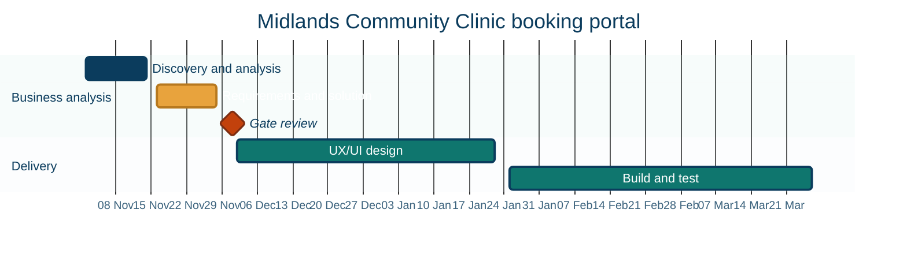

# 01 · Project Brief

| Document ID | Version | Date | Author | Status |
|---|---|---|---|---|
| MCC-BA-01 | 1.0 | 14 November 2026 | Nkosinathi Ndlovu, Business Analyst | Approved |

---

## 1. How this project started

Over the past year I have walked past the Edendale branch of Midlands Community Clinic early in the morning many times. By 05:30 there is already a line at the gate. Some people bring blankets and small chairs. Mothers stand with babies on their backs, and older people lean against the fence because there is nowhere to sit.

When I asked people why they come so early, the answer was always the same: *"If you come late, you don't get a number."* The clinic hands out a fixed number of cards when the gate opens at 07:00. When the cards run out, the rest are told to come back another day. Those who do get a card can still wait four hours or more before they see a nurse.

A neighbour of mine who is partially sighted told me she had been turned away twice in one month while trying to collect her chronic medication. Each trip cost her taxi fare and a full morning. That conversation is the reason this project exists.

I wanted to know whether the problem was really "not enough nurses", or whether part of it was **how people get access to the clinic in the first place**. This project is my attempt to answer that properly, using business analysis before anyone writes code.

## 2. Vision

> Every patient of Midlands Community Clinic can secure a time to be seen **before** leaving home, in a way that works for them, including people who are older, have a disability or do not own a smartphone.

## 3. Business objectives

All objectives are measured against the baselines collected in Phase 1 (see [Elicitation findings](05-elicitation-findings.md)).

| ID | Objective | Baseline | Target | By when |
|---|---|---|---|---|
| BO-01 | Reduce the average wait from arrival to consultation for booked patients | 4 h 12 min | Under 90 min | 12 months after launch |
| BO-02 | Reduce the number of patients turned away each day across all branches | About 40 per day | Under 8 per day (80% fewer) | 12 months after launch |
| BO-03 | Reduce missed follow-up visits | 22% | 10% or less | 9 months after launch |
| BO-04 | Increase the share of visits booked in advance | 0% (walk-in only) | At least 40% | 6 months after launch |
| BO-05 | Make every booking screen meet WCAG 2.2 level AA | Not applicable | 100% of screens | At launch |

## 4. Scope

| In scope | Out of scope |
|---|---|
| Booking, changing and cancelling a visit at any of the three branches | Clinical records and consultation notes |
| Daily slot capacity set per branch and per service | Online consultations or telemedicine |
| SMS confirmations and reminders | Medicine stock management |
| Assisted booking by reception staff for walk-in and phone requests | Payments (public clinic services are free at the point of care) |
| Staff view of the day's bookings and arrivals | Integration with hospital referral systems (future phase) |
| Basic reports for branch and operations managers | WhatsApp booking channel (recommended for a later phase) |

## 5. Key stakeholders

| Role | Name / group | Responsibility on this project |
|---|---|---|
| Project sponsor | Mrs Zanele Mthethwa, Clinic Operations Manager | Owns the budget and final sign-off |
| Business analyst | Nkosinathi Ndlovu | Leads discovery, requirements and traceability |
| Subject matter experts | Sisters-in-charge at each branch | Clinical flow, capacity and service days |
| Key users | Reception clerks, nurses, queue marshals | Daily use of the staff side of the system |
| End users | Patients and caregivers | Booking visits |
| Technical advisor | uMgungundlovu District Health information officer | Data, security and hosting standards |

The full stakeholder analysis is in [03 · Stakeholder analysis](03-stakeholder-analysis.md).

## 6. Early constraints and assumptions

**Constraints**

- C-01: The clinic cannot increase nurse numbers in the next 12 months. Any improvement must come from better use of existing capacity.
- C-02: Walk-in patients and emergencies must still be seen. Booking cannot fully replace walk-ins.
- C-03: Many patients use prepaid data, so the portal must work on low-cost phones and slow connections.
- C-04: Patient information must be handled according to South African health and privacy law (see section 7).

**Assumptions** (to be confirmed in Phase 2)

- A-01: Patients will keep booked times if they receive a reminder the day before.
- A-02: Reception staff have a computer and a stable internet connection at all three branches.
- A-03: Each patient can be identified by their clinic folder number or South African ID number.

## 7. Legal and regulatory context

| Law / standard | Relevant sections | What it means for this project |
|---|---|---|
| **Protection of Personal Information Act 4 of 2013 (POPIA)** | **Section 26 and section 32** (special personal information, including health information) | Booking data shows that a person uses a health service, which is health information. It may only be processed under the conditions the Act allows, such as by a health care body for proper treatment and care. |
| | **Section 19** (security safeguards) | The clinic must keep booking data secure against loss, damage and unauthorised access. |
| | **Section 22** (notification of security compromises) | If booking data is leaked, the clinic must notify the Information Regulator and affected patients. |
| **National Health Act 61 of 2003** | **Section 14** (confidentiality) | Information about a patient's health and the services they use is confidential. Staff screens and SMS messages must not reveal more than needed. |
| | **Section 17** (protection of health records) | Access to records must be controlled and limited to authorised people. |
| **WCAG 2.2, level AA** (international standard) | All success criteria at level A and AA | The portal must be usable with screen readers, keyboard only, large text and low vision. This supports the clinic's duty to serve all patients fairly. |

## 8. Timeline

## 9. Approval

| Name | Role | Decision | Date |
|---|---|---|---|
| Zanele Mthethwa | Clinic Operations Manager (Sponsor) | Approved to proceed to discovery | 2 November 2026 |
