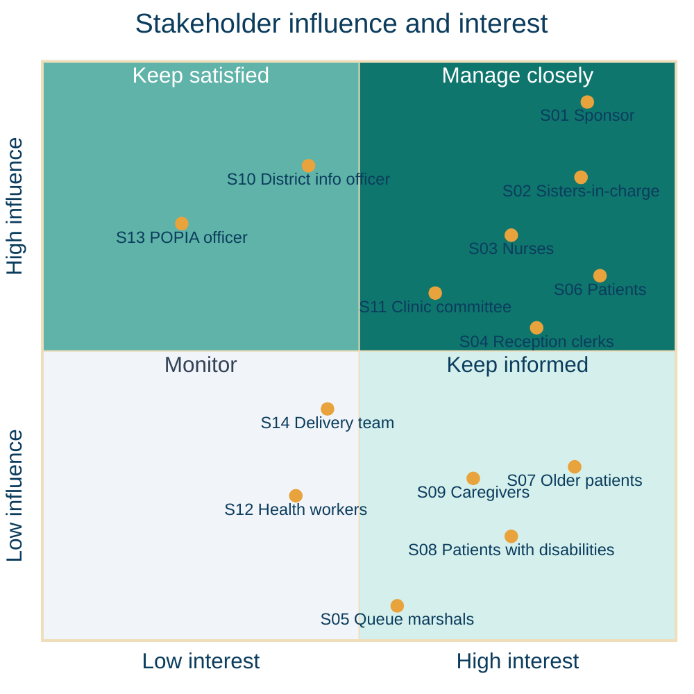

# 03 · Stakeholder Analysis

| Document ID | Version | Date | Author | Status |
|---|---|---|---|---|
| MCC-BA-03 | 1.0 | 14 November 2026 | Nkosinathi Ndlovu, Business Analyst | Approved |

---

## 1. Stakeholder register

Influence and interest are rated **H** (high), **M** (medium) or **L** (low). The same register is available as a spreadsheet: [stakeholder-register.csv](data/stakeholder-register.csv).

| ID | Stakeholder | Role in the clinic | Main interest in this project | Influence | Interest | Current attitude |
|---|---|---|---|:---:|:---:|---|
| S01 | Zanele Mthethwa | Clinic Operations Manager, project sponsor | Shorter queues, fewer complaints, better use of staff | H | H | Champion |
| S02 | Sisters-in-charge (3) | Lead nurse at each branch | Predictable daily workload; walk-ins and emergencies still seen | H | H | Supportive, with concerns |
| S03 | Professional nurses (14) | Triage, consultation and treatment | Less pressure at peak times; no extra admin | M | H | Neutral |
| S04 | Reception clerks (5) | Patient registration and folders | Fewer arguments at the counter; easier folder handling | M | H | Supportive |
| S05 | Queue marshals (security) (4) | Gate control and numbered cards | Safer, calmer mornings at the gate | L | M | Neutral |
| S06 | Patients | Use clinic services | Know they will be seen; spend less time and money | M | H | Very supportive |
| S07 | Older and chronic patients | Monthly check-ups and medication | Avoid early travel and long standing | L | H | Supportive but unsure about technology |
| S08 | Patients with disabilities | Including screen reader and low-vision users | Book independently, without needing help | L | H | Supportive if accessible |
| S09 | Caregivers and parents | Book for children and older relatives | Book for more than one person | L | H | Supportive |
| S10 | District information officer | uMgungundlovu District Health | Data security, hosting standards, reporting | H | M | Cautious |
| S11 | Clinic committee and ward councillors | Community oversight | Fair access for the whole community | M | M | Supportive |
| S12 | Community health workers | Home visits in the clinic's area | Book visits for patients they support | L | M | Supportive |
| S13 | Information Officer (POPIA) | Responsible for personal information compliance | Lawful processing of health information | H | L | Neutral |
| S14 | Future delivery team | UX/UI designer and developers | Clear, testable requirements | M | M | Not yet engaged |

## 2. Power and interest grid

| Quadrant | Approach | Stakeholders |
|---|---|---|
| **Manage closely** | Involve in decisions, review every deliverable | S01, S02, S03, S04, S06, S11 |
| **Keep satisfied** | Consult on security, data and compliance; formal sign-off | S10, S13 |
| **Keep informed** | Regular updates; involve in research and usability testing | S05, S07, S08, S09 |
| **Monitor** | Share key outputs; bring in at the right time | S12, S14 |

> Patients sit near the middle of the grid because they have no formal say in clinic decisions. Their voice is brought in through interviews, the survey and usability testing so that the people with the most to gain are not left out.

## 3. RACI matrix for the business analysis work

**R** = Responsible (does the work) · **A** = Accountable (signs off) · **C** = Consulted · **I** = Informed

| Deliverable | BA (Nathi) | Sponsor (S01) | Sisters-in-charge (S02) | Reception (S04) | District info officer (S10) | POPIA officer (S13) | Clinic committee (S11) |
|---|:---:|:---:|:---:|:---:|:---:|:---:|:---:|
| Project brief | R | A | C | I | I | I | I |
| Business case | R | A | C | I | C | I | I |
| Elicitation plan | R | A | C | C | I | C | I |
| Elicitation findings | R | A | C | C | I | I | I |
| Current-state process model | R | A | C | C | I | I | I |
| Root cause analysis | R | A | C | C | I | I | I |
| Problem statement and KPIs | R | A | C | I | C | I | C |
| Business requirements (Phase 2) | R | A | C | C | C | C | I |
| Data and privacy requirements (Phase 2) | R | A | I | I | C | C | I |
| Gate review sign-off (Phase 2) | R | A | C | I | C | C | I |

## 4. Communication plan

| Audience | What they need | Channel | How often | Owner |
|---|---|---|---|---|
| Sponsor (S01) | Progress, risks, decisions needed | 30-minute status meeting | Weekly (Mondays) | BA |
| Sisters-in-charge (S02) | Findings and draft process changes for review | Branch visit and email | Every two weeks | BA |
| Nurses and clerks (S03, S04) | What is changing and when; chance to give input | Short talk at the morning staff huddle | At each phase end | BA with S02 |
| District info officer (S10) | Data, hosting and security approach | Email and review meeting | At each phase end | BA |
| POPIA officer (S13) | Personal information processing plans | Written review of data requirements | Once in Phase 2 | BA |
| Patients (S06–S09) | That a booking system is coming and how to give feedback | Posters in waiting areas, clinic committee meetings | Monthly | Sponsor |
| Clinic committee (S11) | Fairness of access, walk-in protection | Committee meeting slot | Monthly | Sponsor with BA |
