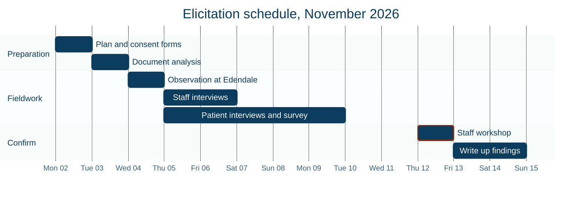

# 04 · Elicitation Plan

| Document ID | Version | Date | Author | Status |
|---|---|---|---|---|
| MCC-BA-04 | 1.0 | 2 November 2026 | Nkosinathi Ndlovu, Business Analyst | Approved |

---

## 1. What we need to find out

1. How a clinic visit works today, step by step, at each branch.
2. Where time is lost, and why.
3. Who is most affected, and what they need from a booking system.
4. What staff need so that a booking system helps them instead of adding work.
5. What data exists today that can be used as a baseline for measuring success.

## 2. Techniques

| Technique | Who | Why this technique | Output |
|---|---|---|---|
| **Document analysis** | Daily attendance registers, follow-up appointment book, card logs | Gives hard numbers before talking to people | Baseline figures |
| **Observation** | Edendale branch gate, reception and waiting area, 05:00 to 16:00 | Shows what really happens, not only what people say happens | Timed observation log |
| **Semi-structured interviews** | 12 patients, 3 sisters-in-charge, 4 nurses, 3 clerks, 2 marshals, sponsor, district information officer | Explores reasons, feelings and workarounds | Interview notes and themes |
| **Survey** | 126 patients across all three branches | Tests how widely the interview themes apply | Survey results |
| **Workshop** | 8 staff from all three branches | Confirms the current process and agrees the biggest problems together | Validated process map and ranked pain points |

## 3. Schedule

## 4. Interview guides

### Patients and caregivers

1. Tell me about your last visit to the clinic, from the time you left home.
2. What time did you arrive, and why that time?
3. How long did you wait, and where? What did you do while you waited?
4. Have you ever been sent home without being seen? What happened next?
5. How much does one visit cost you in transport and lost time or income?
6. If you could choose a time to come in, how would you like to choose it?
7. What phone do you use? Do you use WhatsApp, the internet or SMS?
8. Is there anything that makes the clinic hard for you to use, for example reading, walking or hearing?

### Nurses and sisters-in-charge

1. Walk me through a normal day from 07:00 to closing.
2. When is the busiest time, and what makes it busy?
3. How do you decide how many patients can be seen in a day?
4. Which services run on specific days, and do patients know this?
5. What happens when a follow-up patient does not come back?
6. What would worry you about patients booking ahead?

### Reception clerks and queue marshals

1. What happens at the gate and the counter between 06:00 and 09:00?
2. How long does it take to find a patient's folder? What happens when you can't find it?
3. What do patients most often argue or complain about?
4. What would make your mornings easier?

### Sponsor and district information officer

1. What does success look like for you in one year?
2. What data do you report today, and to whom?
3. What rules must any new system follow for hosting, security and privacy?
4. What budget and timeline constraints should I know about?

## 5. Consent and privacy

- Every participant is told what the research is for and that taking part is voluntary.
- Verbal consent is recorded on the interview sheet before starting.
- No names, ID numbers or folder numbers are written down. Participants are recorded by code only (for example **P04** or **N02**).
- No questions are asked about diagnoses or medical conditions. This keeps the research outside the processing of health information covered by POPIA sections 26 and 32.
- Survey forms are anonymous and stored in a locked cabinet at the sponsor's office.
