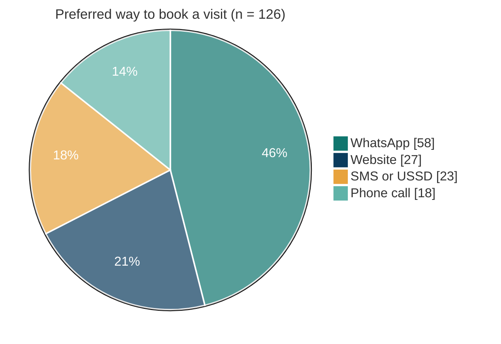
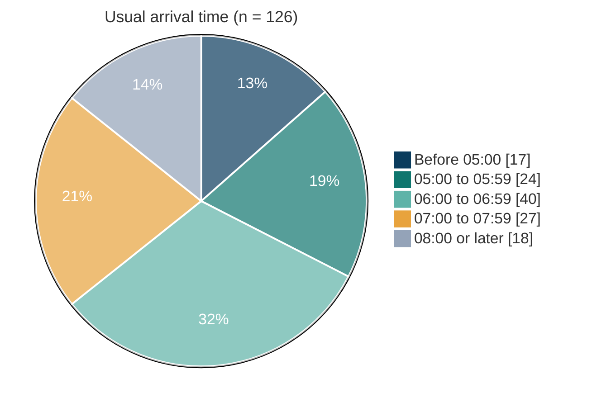

# 05 · Elicitation Findings

| Document ID | Version | Date | Author | Status |
|---|---|---|---|---|
| MCC-BA-05 | 1.0 | 14 November 2026 | Nkosinathi Ndlovu, Business Analyst | Approved |

---

## 1. Summary of activities

| Activity | Date | Participants | Status |
|---|---|---|:---:|
| Document analysis (registers and appointment book) | 3 Nov 2026 | September 2026 records, 3 branches | ✅ |
| Observation at Edendale branch | 4 Nov 2026 | 05:00 to 16:00, one full day | ✅ |
| Staff interviews | 5–6 Nov 2026 | 14 staff (including sponsor and district officer) | ✅ |
| Patient interviews | 5–11 Nov 2026 | 12 patients and caregivers | ✅ |
| Patient survey | 5–11 Nov 2026 | 126 patients (Scottsville 34, Edendale 52, Imbali 40) | ✅ |
| Staff workshop | 12 Nov 2026 | 8 staff from all branches | ✅ |

## 2. Key findings

| ID | Finding | Evidence | Source |
|---|---|---|---|
| **F-01** | Most patients arrive before the gate opens, out of fear of missing a card. | 64.3% arrive before 07:00; 13.5% before 05:00. | Survey Q1, observation |
| **F-02** | The average wait from arrival to consultation is just over four hours. | 4 h 12 min average across 30 timed patients at Edendale. | Observation |
| **F-03** | About 40 patients a day are turned away across the three branches. | Card logs: Edendale 18, Imbali 13, Scottsville 9 per day on average. 38.1% of surveyed patients were turned away at least once in 6 months. | Documents, survey Q2 |
| **F-04** | Daily capacity is a fixed number of cards, not linked to the services running that day. | Edendale 120, Imbali 100, Scottsville 80 cards a day, every day. | Staff interviews |
| **F-05** | Many patients come on the wrong day for their service. | Sisters-in-charge estimate 1 in 10 patients come on a day their service (for example antenatal care on Tuesdays) is not offered. | Staff interviews, workshop |
| **F-06** | Paper folders are slow to find and sometimes lost. | Average 6 minutes per folder; 9 of 120 folders (7.5%) not found on the observed day. | Observation, clerk interviews |
| **F-07** | Follow-up visits are often missed, and those slots are not reused. | 44 of 200 follow-up dates in September 2026 were missed (22%). | Appointment book |
| **F-08** | Most patients could use a digital booking channel, but not all. | 71.4% have a phone that can browse; 22.2% basic phone only; 6.3% no phone. 83.3% would use online booking. | Survey Q3, Q5 |
| **F-09** | WhatsApp is the most wanted channel, but a website and SMS together reach more people. | WhatsApp 46.0%, website 21.4%, SMS/USSD 18.3%, phone call 14.3%. | Survey Q4 |
| **F-10** | A meaningful group of patients needs accessible design. | 15.9% need help reading small text or use assistive technology. | Survey Q6, patient interviews |
| **F-11** | Staff support booking, but fear that walk-ins and emergencies will be pushed out. | Raised by all 3 sisters-in-charge and in the workshop. | Interviews, workshop |
| **F-12** | There is no demand data. Managers only report total head counts. | Monthly reports show patients seen, not patients turned away or no-shows. | Sponsor and district interviews |

## 3. Patient survey highlights

The full results by branch are in [patient-survey-results.csv](data/patient-survey-results.csv).

## 4. What people told us

Participants are identified by code only. **P** = patient, **N** = nurse or sister, **C** = clerk, **M** = marshal.

| Theme | What we heard |
|---|---|
| Fear of missing out | P02, a pensioner from Imbali, said she leaves home at 04:30 because "the numbers finish before eight." |
| Cost of a wasted trip | P07, a parent, explained that a return taxi trip costs about R40, and being turned away means paying it twice and missing a day of piece work. |
| Accessibility | P09, who uses a screen reader, said she cannot read the handwritten next-visit date on her clinic card and depends on her daughter to tell her. |
| Wrong day for the service | N01 said mothers often arrive for antenatal care on a Thursday, when it only runs on Tuesdays and Wednesdays. |
| Staff pressure | C02 described 07:00 to 09:00 as "the war hours", with arguments at the counter about lost folders and queue jumping. |
| Missed follow-ups | N03 said the clinic has no way to remind patients, so "if they forget, that slot is just lost." |
| Protecting walk-ins | N02 asked: "What about the person who is sick today and did not book? We cannot send them away." |

## 5. Observation log: Edendale branch, Tuesday 4 November 2026

| Time | What was observed |
|---|---|
| 05:20 | First 14 people in the queue outside the gate. No shelter or seating. |
| 06:30 | Queue has grown to 63 people. Two older patients sit on the pavement. |
| 07:00 | Gate opens. Marshal hands out numbered cards in queue order. |
| 07:40 | All 120 cards issued. 18 people told to come back another day. Some argue, two leave in tears. |
| 08:10 | Reception folder searches take 4 to 9 minutes each. Queue at the counter reaches 30 people. |
| 09:30 | 9 folders not found; temporary folders opened, which means no medical history at the consultation. |
| 11:30 | Waiting area full: 70 seated, about 25 standing. |
| 13:00 | Nurses take staggered lunch breaks; only 2 of 4 consulting rooms open for one hour. |
| 15:30 | Last card-holder seen. Average arrival-to-consultation time for 30 timed patients: **4 h 12 min**. |

## 6. Staff workshop outcome (12 November 2026)

Eight staff reviewed the draft current-state process and voted on the pain points that hurt patients and staff most. Each person had five votes.

| Rank | Pain point | Votes |
|:---:|---|:---:|
| 1 | Pre-dawn queue and fixed card limit | 11 |
| 2 | Folder searches at the counter | 9 |
| 3 | Patients coming on the wrong day for their service | 8 |
| 4 | Missed follow-ups with no reminder | 7 |
| 5 | No way to tell how busy tomorrow will be | 5 |

The group also agreed that **at least 30% of daily capacity must stay open for walk-ins and emergencies**. This becomes a business rule in Phase 2.
