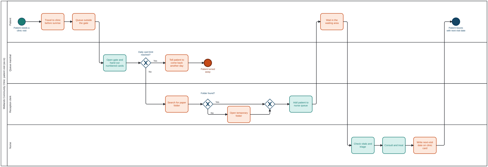
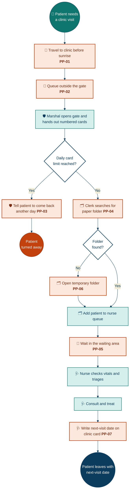

# 06 · Current-State Process (As-Is)

| Document ID | Version | Date | Author | Status |
|---|---|---|---|---|
| MCC-BA-06 | 1.0 | 13 November 2026 | Nkosinathi Ndlovu, Business Analyst | Approved (validated in staff workshop) |

---

## 1. Process overview

| | |
|---|---|
| **Process name** | Patient clinic visit (walk-in) |
| **Trigger** | A patient needs care, a check-up or chronic medication |
| **End states** | Patient is seen and leaves with a next-visit date **or** patient is turned away |
| **Participants** | Patient, queue marshal, reception clerk, nurse |
| **Frequency** | About 340 arrivals a day across 3 branches (300 seen, about 40 turned away) |
| **Formal model** | [as-is-clinic-visit.bpmn](models/as-is-clinic-visit.bpmn) (BPMN 2.0, open in [bpmn.io](https://demo.bpmn.io) or Camunda Modeler) |

## 2. BPMN 2.0 model

This is the formal model, drawn in BPMN 2.0 with one lane per role. Tasks in **coral** are pain points.

## 3. Annotated process map

The same process, with each pain point numbered so it can be traced to the table in section 4.

Role key: 👤 Patient · 🛡️ Queue marshal · 🗂️ Reception clerk · 🩺 Nurse

## 4. Pain points

| ID | Step | Pain point | Who it hurts | Evidence |
|---|---|---|---|---|
| PP-01 | Travel to clinic | Patients leave home as early as 04:30 and travel in the dark | Patients, especially older people and mothers | F-01 |
| PP-02 | Queue outside the gate | Hours of standing with no shelter or seating | Patients | F-01, observation 05:20–07:00 |
| PP-03 | Turn patient away | About 40 people a day leave without care and must pay to return | Patients, marshals | F-03 |
| PP-04 | Search for folder | 4 to 9 minutes per folder at the counter during the busiest hours | Clerks, patients | F-06 |
| PP-05 | Wait in waiting area | Average total wait of 4 h 12 min; waiting area overflows | Patients, nurses | F-02 |
| PP-06 | Temporary folder | Nurse consults without the patient's history | Nurses, patients | F-06 |
| PP-07 | Next-visit date on card | Handwritten dates are lost or unreadable; no reminder; 22% missed | Patients, nurses | F-07, P09 |
| PP-08 | (Across the whole process) | Capacity is a fixed card count, not linked to services offered that day | Sisters-in-charge, patients | F-04, F-05 |

## 5. Current-state measures

| Measure | Value | Source |
|---|---|---|
| Patients seen per day (3 branches) | About 300 | Attendance registers |
| Patients turned away per day | About 40 | Card logs |
| Average arrival-to-consultation time | 4 h 12 min | Observation (30 patients) |
| Average folder search time | 6 min | Observation |
| Folders not found | 7.5% | Observation |
| Missed follow-up visits | 22% | Appointment book, September 2026 |
| Visits booked in advance | 0% | Walk-in only |
