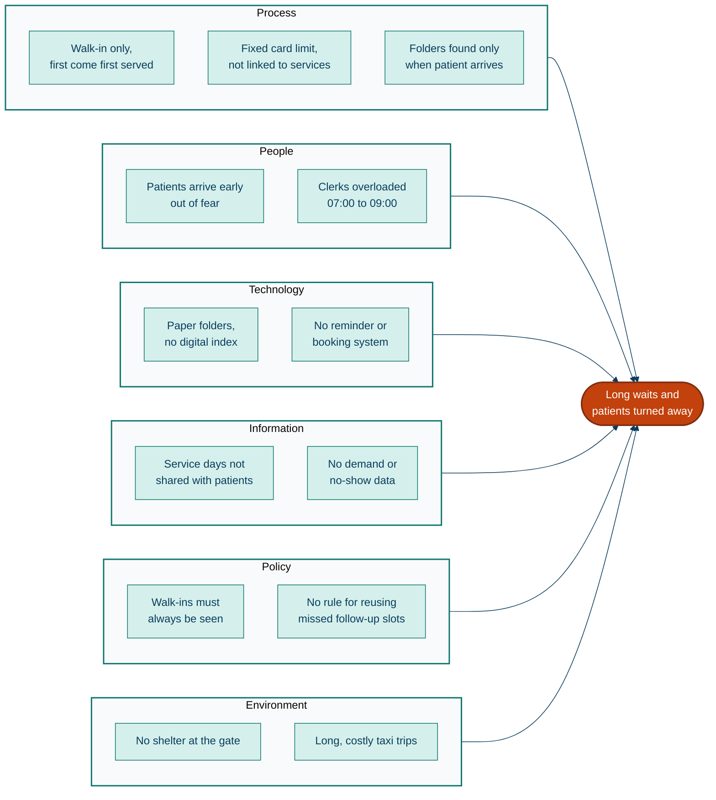

# 07 · Root Cause Analysis

| Document ID | Version | Date | Author | Status |
|---|---|---|---|---|
| MCC-BA-07 | 1.0 | 14 November 2026 | Nkosinathi Ndlovu, Business Analyst | Approved |

---

## 1. Why this step matters

It would be easy to say "the clinic needs more nurses." That is outside the clinic's control for at least 12 months (constraint C-01). Root cause analysis looks for the causes the clinic **can** change, so that the solution treats the cause and not only the symptom.

## 2. Fishbone (Ishikawa) diagram

**Effect:** long waits and about 40 patients turned away every day.

## 3. 5 Whys

### Problem A: About 40 patients are turned away every day

| | Question | Answer | Evidence |
|---|---|---|---|
| Why 1 | Why are patients turned away? | The day's numbered cards have run out. | F-03, observation 07:40 |
| Why 2 | Why do the cards run out? | Everyone arrives at once in the morning, and the limit is reached within 40 minutes. | F-01 |
| Why 3 | Why does everyone arrive at once? | It is the only way to secure a place; there is no way to reserve a time. | Patient interviews |
| Why 4 | Why can't patients reserve a time? | The clinic has no booking process; access is walk-in only. | F-04 |
| Why 5 | Why is there no booking process? | The clinic has never had a tool to plan and share daily capacity by service and time. | F-12, sponsor interview |

**Root cause:** the clinic has no way to plan demand ahead of the day, so capacity is handed out at the gate (**RC-01**).

### Problem B: The average wait is over four hours

| | Question | Answer | Evidence |
|---|---|---|---|
| Why 1 | Why do patients wait so long? | Most of the day's patients are in the building by 08:00, but they are seen one at a time until 15:30. | Observation |
| Why 2 | Why is the start of the day so slow? | Reception must find each paper folder before a patient can join the nurse queue. | F-06 |
| Why 3 | Why are folders found only when the patient arrives? | Staff do not know who is coming that day. | Clerk interviews |
| Why 4 | Why don't staff know who is coming? | There are no bookings, so no list of expected patients exists. | F-04 |
| Why 5 | Why is demand so uneven and unpredictable? | There is no booking or reminder system, and patients are not told which services run on which days. | F-05, F-07 |

**Root causes:** folders cannot be prepared in advance (**RC-02**), patients lack information about service days (**RC-04**), and there is no reminder system (**RC-05**).

## 4. Root causes

| ID | Root cause | Findings | Pain points | Can the clinic change it? |
|---|---|---|---|:---:|
| **RC-01** | No way to plan and reserve capacity before the day; access is walk-in only. | F-01, F-03, F-04 | PP-01, PP-02, PP-03 | ✅ Yes |
| **RC-02** | Folders are found at the counter because there is no list of expected patients. | F-06 | PP-04, PP-06 | ✅ Yes |
| **RC-03** | Daily capacity is a fixed card count, not linked to the services offered each day. | F-04, F-05 | PP-08 | ✅ Yes |
| **RC-04** | Patients are not told which services run on which days. | F-05 | PP-05, PP-08 | ✅ Yes |
| **RC-05** | There is no reminder for follow-ups, and missed slots are not reused. | F-07 | PP-07 | ✅ Yes |
| (Context) | Not enough nurses for total demand. | Sponsor interview | PP-05 | ❌ Not in the next 12 months (C-01) |

## 5. What this tells us

Four of the five root causes come from **missing information at the right time**: the clinic does not know who is coming, and patients do not know when to come. A booking system with reminders addresses RC-01, RC-02, RC-03 and RC-05 directly, and a public service-day calendar addresses RC-04. Walk-in capacity must still be protected (finding F-11).
