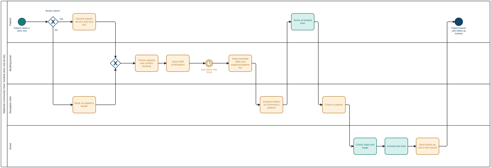
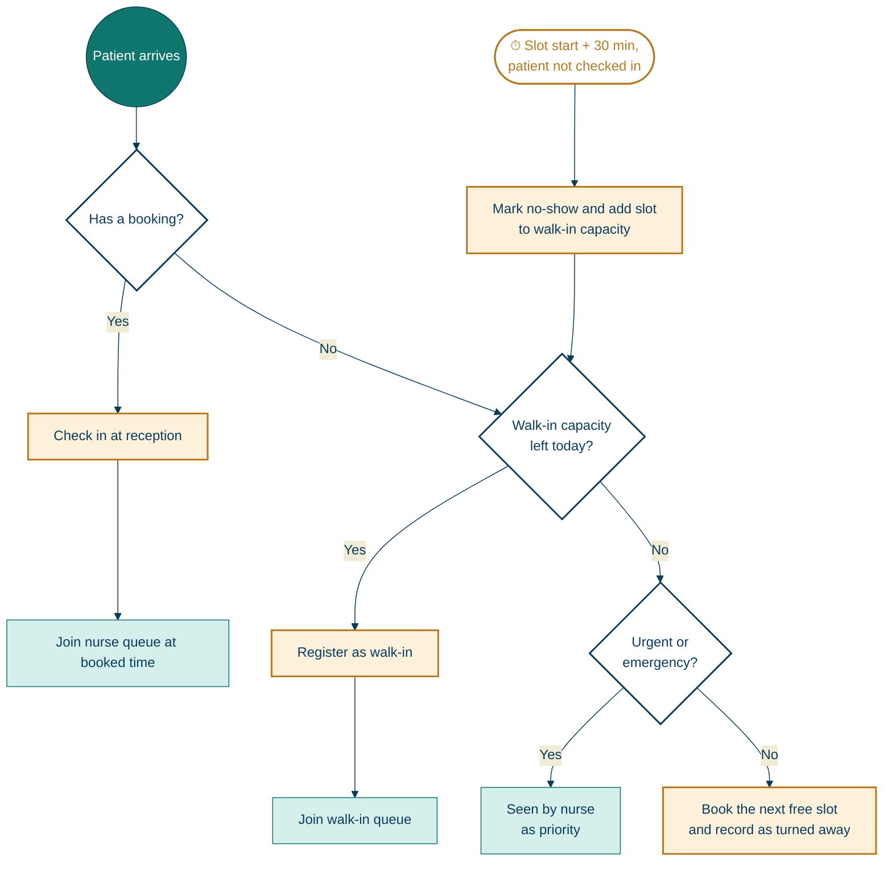

# 01 · Future-State Process (To-Be)

| Document ID | Version | Date | Author | Status |
|---|---|---|---|---|
| MCC-BA-10 | 1.0 | 20 November 2026 | Nkosinathi Ndlovu, Business Analyst | Approved |

---

## 1. What changes

| | Today (as-is) | Future (to-be) |
|---|---|---|
| **How a patient gets a place** | Queue at the gate for a numbered card | Book a time slot online, at reception, or through a community health worker |
| **When the clinic knows demand** | When people are already at the gate | Up to 14 days ahead |
| **Folders** | Searched for at the counter while the patient waits | Pulled the afternoon before from the expected-patient list |
| **Reminders** | None; next date handwritten on a card | SMS confirmation and a reminder the day before |
| **Missed visits** | Slot is lost | Released to walk-ins 30 minutes after the slot start |
| **Walk-ins and emergencies** | Compete for the same cards | At least 30% of capacity protected for them |
| **Management data** | Head count only | Daily bookings, arrivals, no-shows, walk-ins and turned away |

## 2. BPMN 2.0 model

Tasks in **amber** are new or changed. Tasks in **teal** stay the same. The model file is [to-be-booked-visit.bpmn](models/to-be-booked-visit.bpmn) (open in [bpmn.io](https://demo.bpmn.io) or Camunda Modeler).

## 3. Walk-in and slot release flow

Booking does not replace walk-ins. This flow shows how the two work together on the day.

## 4. How the future state addresses each pain point

| Pain point | Root cause | How the future state fixes it |
|---|---|---|
| PP-01 Travel before sunrise | RC-01 | Patients arrive at their booked time |
| PP-02 Queue outside the gate | RC-01 | No need to queue for a card; walk-ins are registered at reception |
| PP-03 Patients turned away | RC-01, RC-03 | Capacity is planned ahead; turned-away patients leave with a booked slot |
| PP-04 Folder search at the counter | RC-02 | Folders are pulled the afternoon before |
| PP-05 Long wait in the waiting area | RC-01, RC-04 | Arrivals are spread across the day by time slot |
| PP-06 Temporary folders | RC-02 | Missing folders are found or flagged a day early |
| PP-07 Lost next-visit dates | RC-05 | Follow-ups are booked in the system with SMS reminders |
| PP-08 Fixed card limit | RC-03 | Capacity is set per service and per day by the sister-in-charge |
