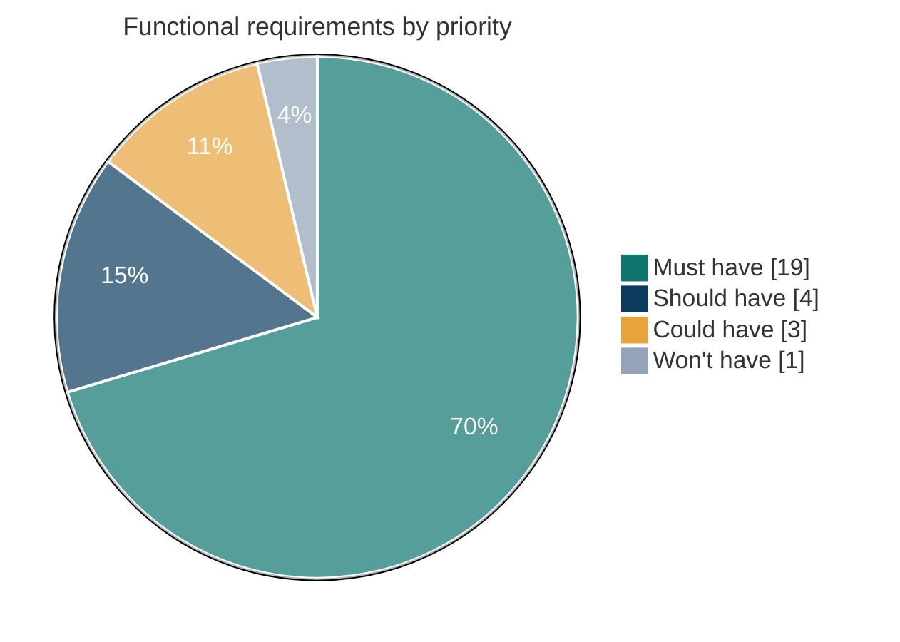

# 03 · Functional and Non-Functional Requirements

| Document ID | Version | Date | Author | Status |
|---|---|---|---|---|
| MCC-BA-12 | 1.0 | 27 November 2026 | Nkosinathi Ndlovu, Business Analyst | Approved |

---

Each requirement is written to be **clear, testable and traceable**. Priorities use **MoSCoW**: 🟢 Must have · 🔵 Should have · 🟡 Could have · ⚪ Won't have this release.

## 1. Functional requirements

### E1 · Patient booking

| ID | Requirement | Priority | Business req. | Story | Test |
|---|---|---|---|---|---|
| **FR-01** | The system shall let a patient register with a South African mobile number, verified by a one-time PIN (OTP). | 🟢 Must | BR-01 | US-01 | UAT-01 |
| **FR-02** | The system shall let a patient link a South African ID number, passport or asylum document number, or clinic folder number to their profile. | 🟢 Must | BR-09 | US-01 | UAT-01 |
| **FR-03** | The system shall show each branch's service calendar (services, days and hours) without the patient having to log in. | 🟢 Must | BR-05 | US-02 | UAT-02 |
| **FR-04** | The system shall show available time slots for a chosen branch, service and date, up to 14 days ahead. | 🟢 Must | BR-01 | US-03 | UAT-03 |
| **FR-05** | The system shall confirm a booking on screen with a booking reference, branch, date and time. | 🟢 Must | BR-01 | US-03 | UAT-03 |
| **FR-06** | The system shall let a patient reschedule or cancel a booking up to 2 hours before the slot, and return the slot to the pool straight away. | 🟢 Must | BR-04 | US-04 | UAT-04 |
| **FR-07** | The system shall enforce booking rules BRL-03, BRL-04 and BRL-05 (one booking per service per day, services only on their days, 14-day booking window). | 🟢 Must | BR-02 | US-03 | UAT-05 |
| **FR-08** | The system shall let a caregiver add up to 5 dependants and book for them, recording each dependant's consent. | 🔵 Should | BR-01 | US-05 | UAT-06 |

### E2 · Notifications

| ID | Requirement | Priority | Business req. | Story | Test |
|---|---|---|---|---|---|
| **FR-09** | The system shall send an SMS confirmation within 1 minute of a booking being made or changed. | 🟢 Must | BR-04 | US-06 | UAT-07 |
| **FR-10** | The system shall send a reminder SMS at 15:00 on the day before each booked visit. | 🟢 Must | BR-04 | US-06 | UAT-07 |
| **FR-11** | SMS messages shall contain only the clinic name, branch, date, time and booking reference. They shall never name the service or a condition. | 🟢 Must | BR-09 | US-06 | UAT-07 |
| **FR-12** | The system shall let a patient cancel a booking by replying CANCEL to the reminder SMS. | 🟡 Could | BR-04 | US-07 | UAT-08 |

### E3 · Front desk and clinic day

| ID | Requirement | Priority | Business req. | Story | Test |
|---|---|---|---|---|---|
| **FR-13** | Reception clerks shall be able to find a patient by phone, ID or folder number and book a visit on their behalf. | 🟢 Must | BR-06 | US-08 | UAT-09 |
| **FR-14** | The system shall produce a printable list of the next day's expected patients per branch by 15:00, sorted by time and showing folder numbers. | 🟢 Must | BR-03 | US-09 | UAT-10 |
| **FR-15** | Reception clerks shall be able to check in a patient and record the arrival time. | 🟢 Must | BR-08 | US-10 | UAT-11 |
| **FR-16** | The system shall release a booked slot to walk-ins and mark the booking as a no-show if the patient has not checked in 30 minutes after the slot start time. | 🟢 Must | BR-04 | US-11 | UAT-12 |
| **FR-17** | Reception clerks shall be able to register walk-in patients into the same day's queue until walk-in capacity is used up. | 🟢 Must | BR-02 | US-12 | UAT-13 |
| **FR-18** | Reception clerks shall be able to record each patient turned away, with a reason. | 🔵 Should | BR-08 | US-12 | UAT-13 |
| **FR-19** | Nurses shall be able to book a follow-up visit at the end of a consultation. | 🔵 Should | BR-04 | US-13 | UAT-14 |

### E4 · Clinic set-up

| ID | Requirement | Priority | Business req. | Story | Test |
|---|---|---|---|---|---|
| **FR-20** | Sisters-in-charge shall be able to set daily capacity and slot length per service at their branch. The walk-in share cannot be set below 30%. | 🟢 Must | BR-02 | US-14 | UAT-15 |
| **FR-21** | Sisters-in-charge shall be able to manage the service calendar, including closures and public holidays. Patients with affected bookings receive an SMS. | 🟢 Must | BR-05 | US-15 | UAT-16 |
| **FR-22** | Administrators shall be able to create, change and deactivate staff accounts with roles: clerk, nurse, sister-in-charge, manager and administrator. | 🟢 Must | BR-09 | US-16 | UAT-17 |

### E5 · Reporting

| ID | Requirement | Priority | Business req. | Story | Test |
|---|---|---|---|---|---|
| **FR-23** | The system shall show a daily dashboard per branch with bookings, arrivals, no-shows, walk-ins, patients turned away and average wait time. | 🟢 Must | BR-08 | US-17 | UAT-18 |
| **FR-24** | Managers shall be able to export monthly figures as a CSV file for district reporting. | 🔵 Should | BR-08 | US-18 | UAT-18 |

### E6 · Future channels

| ID | Requirement | Priority | Business req. | Story | Test |
|---|---|---|---|---|---|
| **FR-25** | Patients shall be able to book through a USSD menu on any phone. | 🟡 Could | BR-06 | — | — |
| **FR-26** | The system shall send a queue update SMS when a patient is about 30 minutes from being called. | 🟡 Could | BR-01 | — | — |
| **FR-27** | Patients shall be able to book through WhatsApp. | ⚪ Won't | BR-06 | — | — |

## 2. Non-functional requirements

| ID | Category | Requirement | Priority | Business req. | Test |
|---|---|---|---|---|---|
| **NFR-01** | Accessibility | All patient and staff screens shall meet WCAG 2.2 level AA, and be tested with NVDA and TalkBack screen readers. | 🟢 Must | BR-07 | UAT-19 |
| **NFR-02** | Performance | Patient pages shall load in under 3 seconds on a 3G connection, with each page under 500 KB. | 🟢 Must | BR-01 | UAT-20 |
| **NFR-03** | Availability | The system shall be available 99.5% of the time between 06:00 and 20:00, seven days a week. | 🟢 Must | BR-01 | UAT-20 |
| **NFR-04** | Security | All data shall be encrypted in transit (TLS 1.2 or higher) and at rest. Staff accounts shall use multi-factor authentication. | 🟢 Must | BR-09 | UAT-17 |
| **NFR-05** | Audit | Every staff view or change of a patient's details shall be logged with user, date and time, and kept for 3 years. | 🟢 Must | BR-09 | UAT-17 |
| **NFR-06** | Data residency and retention | Patient data shall be stored in a cloud region inside South Africa. Booking records older than 24 months shall be anonymised. | 🟢 Must | BR-09 | — |
| **NFR-07** | Language | Patient screens and SMS messages shall be available in English and isiZulu. | 🔵 Should | BR-07 | UAT-21 |
| **NFR-08** | Resilience | Check-in shall keep working for up to 4 hours without internet and sync automatically when the connection returns. | 🔵 Should | BR-03 | UAT-11 |
| **NFR-09** | Compatibility | Patient screens shall work from 320 px wide, on Chrome for Android 8 and newer, and on current Safari, Edge and Firefox. | 🟢 Must | BR-01 | UAT-20 |
| **NFR-10** | Usability | At least 80% of first-time users shall complete a booking in under 3 minutes in usability testing. | 🟢 Must | BR-01 | UAT-22 |

## 3. MoSCoW summary

| Priority | Functional requirements | Share |
|---|:---:|:---:|
| 🟢 Must have | 19 | 70% |
| 🔵 Should have | 4 | 15% |
| 🟡 Could have | 3 | 11% |
| ⚪ Won't have (this release) | 1 | 4% |
| **Total** | **27** | **100%** |

**How priorities were set:** a requirement is a **Must** if, without it, the clinic cannot meet a business objective or would break the law. All Must items were reviewed with the sponsor and sisters-in-charge in the prioritisation workshop on 24 November 2026. WhatsApp booking (FR-27) is a **Won't** for this release because of per-conversation costs and accessibility concerns (see [Business case](../01-discovery/02-business-case.md)). It is planned for a later release.
