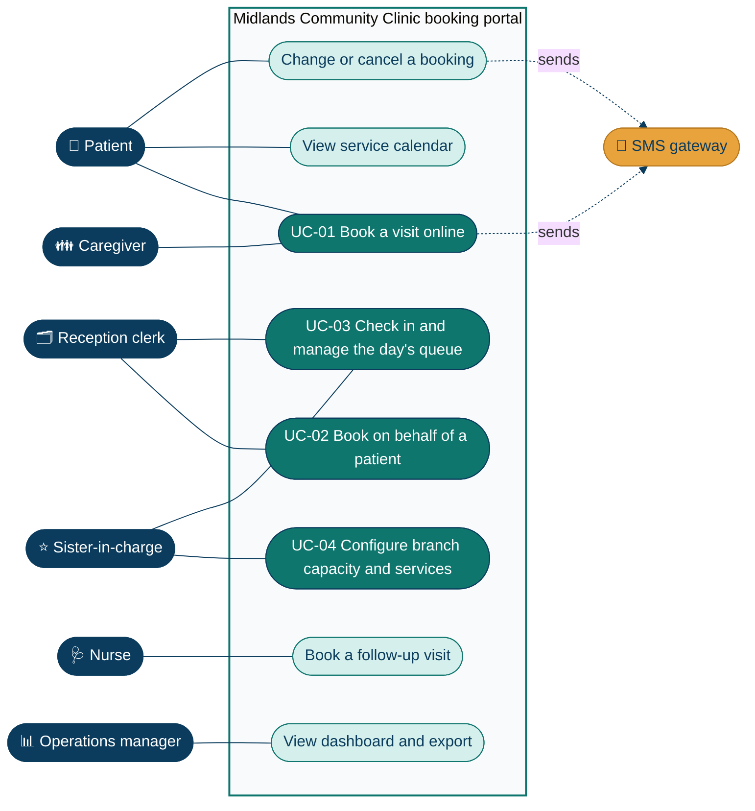

# 04 · Use Cases

| Document ID | Version | Date | Author | Status |
|---|---|---|---|---|
| MCC-BA-13 | 1.0 | 25 November 2026 | Nkosinathi Ndlovu, Business Analyst | Approved |

---

## 1. Use case diagram

The four main use cases (dark teal) are described in full below. The others are covered by user stories.

---

## UC-01 · Book a visit online

| | |
|---|---|
| **Primary actor** | Patient (or caregiver booking for a dependant) |
| **Goal** | Reserve a time slot for a service at a branch |
| **Preconditions** | Patient is registered and signed in |
| **Postconditions** | Booking is saved, slot capacity drops by one, confirmation SMS is sent |
| **Trigger** | Patient chooses "Book a visit" |
| **Requirements** | FR-03 to FR-09, BRL-03 to BRL-05 |

**Main success scenario**

1. Patient chooses **Book a visit**.
2. System shows the three branches.
3. Patient chooses a branch.
4. System shows the services offered at that branch and the days each one runs.
5. Patient chooses a service.
6. System shows the next 14 days, with days the service does not run marked as unavailable.
7. Patient chooses a date.
8. System shows the time slots for that date, marking full slots with the word **Full**.
9. Patient chooses an open slot.
10. System shows a summary: branch, service, date and time.
11. Patient confirms.
12. System saves the booking, shows the booking reference and sends a confirmation SMS.

**Alternative flows**

- **3a. Caregiver booking:** before step 3, the caregiver chooses which dependant the booking is for.
- **7a. No slots left on the chosen date:** system suggests the next date with open slots.

**Exceptions**

- **11a. Slot taken by someone else during booking:** system says the slot is no longer available and returns to step 8.
- **11b. Patient already has a booking for this service on this day (BRL-03):** system shows the existing booking and does not create another.
- **12a. SMS gateway unavailable:** the booking is still saved; the SMS is retried every 5 minutes for 1 hour.

---

## UC-02 · Book on behalf of a patient

| | |
|---|---|
| **Primary actor** | Reception clerk |
| **Goal** | Book a visit for a patient who cannot book online |
| **Preconditions** | Clerk is signed in |
| **Postconditions** | Booking saved; SMS sent if the patient has a phone |
| **Requirements** | FR-13, BRL-06 |

**Main success scenario**

1. Clerk chooses **Book for a patient**.
2. Clerk searches by cellphone number, ID or passport number, or folder number.
3. System shows matching patients.
4. Clerk selects the patient.
5. Steps 3 to 12 of UC-01 follow, done by the clerk.

**Alternative flows**

- **3a. No match found:** clerk creates a new profile with name, contact number (optional) and folder number, then continues.

---

## UC-03 · Check in and manage the day's queue

| | |
|---|---|
| **Primary actor** | Reception clerk |
| **Supporting actor** | Sister-in-charge |
| **Goal** | Record arrivals, register walk-ins and keep capacity in use |
| **Preconditions** | Expected-patient list for today exists |
| **Postconditions** | Every patient is either checked in, a no-show, a walk-in or recorded as turned away |
| **Requirements** | FR-15 to FR-18, BRL-01, BRL-02, NFR-08 |

**Main success scenario**

1. Patient arrives at reception.
2. Clerk searches by booking reference or cellphone number.
3. System shows the booking.
4. Clerk marks the patient as arrived.
5. System records the arrival time and adds the patient to the nurse queue.

**Alternative flows**

- **2a. Patient has no booking:** clerk checks walk-in capacity. If capacity is left, the clerk registers a walk-in. If not, and the case is not urgent, the clerk books the next free slot and records the patient as turned away.
- **Timer. Slot start + 30 minutes with no check-in:** system marks the booking as a no-show and adds the slot to walk-in capacity (BRL-02).

**Exceptions**

- **4a. Internet is down:** check-in is saved on the device and synced when the connection returns (NFR-08).

---

## UC-04 · Configure branch capacity and services

| | |
|---|---|
| **Primary actor** | Sister-in-charge |
| **Goal** | Match bookable slots to the staff and services available |
| **Preconditions** | Signed in with the sister-in-charge role |
| **Postconditions** | New capacity applies to future dates |
| **Requirements** | FR-20, FR-21, BRL-01, BRL-11 |

**Main success scenario**

1. Sister-in-charge opens **Branch settings**.
2. System shows each service with its days, hours, slot length and daily capacity.
3. Sister-in-charge changes a value and saves.
4. System checks that the walk-in share is at least 30%.
5. System applies the change to future dates.

**Exceptions**

- **4a. Walk-in share below 30%:** system shows an error and does not save.
- **5a. Change affects existing bookings (for example a closure):** system lists affected bookings and, once confirmed, sends each patient an SMS to rebook.
