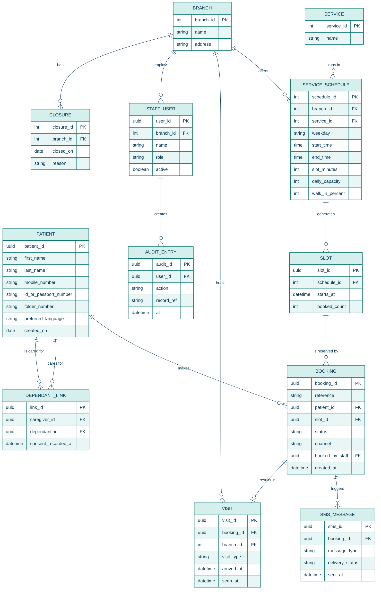
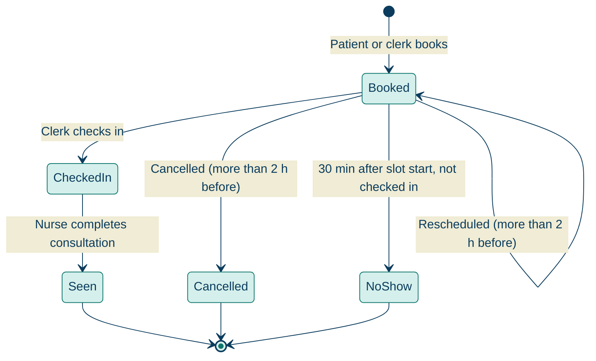

# 06 · Data Model and Data Dictionary

| Document ID | Version | Date | Author | Status |
|---|---|---|---|---|
| MCC-BA-15 | 1.0 | 26 November 2026 | Nkosinathi Ndlovu, Business Analyst | Approved |

---

## 1. Conceptual data model (ERD)

This model shows the business information the portal must hold and how it connects. It is a **logical** model for the business and the delivery team; database design follows in the build phase.

## 2. Data dictionary (key fields)

**Classification** follows POPIA: 🔴 **Special personal information** (reveals use of a health service), 🟠 **Personal information**, 🟢 **Operational** (no personal data).

| Entity | Field | Description | Example | Rules | Class |
|---|---|---|---|---|:---:|
| PATIENT | mobile_number | Number used to sign in and receive SMS | 0721234567 | 10 digits, starts with 0, verified by OTP | 🟠 |
| PATIENT | id_or_passport_number | SA ID, passport or asylum document number | 9001015800087 | Optional if folder number given (BRL-06); SA ID passes checksum | 🟠 |
| PATIENT | folder_number | Clinic paper folder reference | EDN-004512 | Branch prefix + 6 digits | 🔴 |
| PATIENT | preferred_language | Language for screens and SMS | zu | en or zu | 🟢 |
| DEPENDANT_LINK | consent_recorded_at | When the dependant's consent was confirmed | 2026-12-03 10:14 | Required before any booking for a dependant (BRL-08) | 🟠 |
| SERVICE_SCHEDULE | walk_in_percent | Share of capacity kept for walk-ins | 30 | Whole number, minimum 30 (BRL-01) | 🟢 |
| SERVICE_SCHEDULE | slot_minutes | Length of one slot | 15 | Set by sister-in-charge (BRL-11) | 🟢 |
| BOOKING | reference | Short code shown to the patient | MCC-7KQ2 | Unique, 4 characters after prefix, no 0/O or 1/I | 🔴 |
| BOOKING | status | Where the booking is in its life | Booked | Booked, Checked in, Seen, No-show, Cancelled | 🔴 |
| BOOKING | channel | How the booking was made | Online | Online, Reception, Health worker, Nurse follow-up | 🟢 |
| VISIT | visit_type | Booked or walk-in | Walk-in | Booked, Walk-in, Turned away | 🔴 |
| VISIT | arrived_at / seen_at | Used to measure wait time (BO-01) | 08:02 / 08:41 | seen_at ≥ arrived_at | 🔴 |
| SMS_MESSAGE | message_type | Why the SMS was sent | Reminder | Confirmation, Reminder, Change, Cancellation, Closure | 🟢 |
| AUDIT_ENTRY | action | What a staff user did | Viewed patient | Kept 3 years (NFR-05) | 🟠 |

## 3. Booking status life cycle

## 4. Data protection notes

- Only the minimum data needed to book and identify a patient is collected. **No diagnoses, symptoms or clinical notes** are stored in this system.
- The **service** a patient books (for example antenatal care) can reveal health information, so bookings are treated as special personal information under POPIA sections 26 and 32.
- Staff see patient details only for their own branch, according to role (FR-22). Every view is logged (NFR-05).
- Booking records older than 24 months are anonymised; aggregate figures are kept for reporting (NFR-06).
