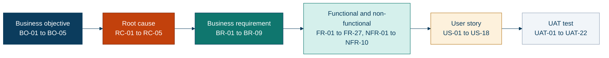

# 08 · Requirements Traceability Matrix

| Document ID | Version | Date | Author | Status |
|---|---|---|---|---|
| MCC-BA-17 | 1.0 | 27 November 2026 | Nkosinathi Ndlovu, Business Analyst | Approved |

---

The traceability matrix links every requirement **backwards** to the business objective and root cause it serves, and **forwards** to the user story, use case and test that prove it. This makes sure nothing is built without a reason and nothing important goes untested. The same matrix is available as a spreadsheet: [requirements-traceability-matrix.csv](data/requirements-traceability-matrix.csv).

## Business requirements

| ID | Business requirement | Objectives | Root cause / source |
|---|---|---|---|
| **BR-01** | Patients must be able to reserve a visit time before leaving home. | BO-01, BO-02, BO-04 | RC-01 |
| **BR-02** | The clinic must be able to set capacity per branch, service and day, while protecting space for walk-ins. | BO-02 | RC-03 |
| **BR-03** | Staff must know which patients are expected before the day starts. | BO-01 | RC-02 |
| **BR-04** | Patients must be reminded of upcoming visits, and missed slots must be reused. | BO-03 | RC-05 |
| **BR-05** | Patients must be able to see which services run on which days at each branch. | BO-02 | RC-04 |
| **BR-06** | Patients without a smartphone must still be able to book. | BO-04 | RC-01 |
| **BR-07** | The solution must be usable by people with disabilities. | BO-05 | F-10 |
| **BR-08** | Managers must be able to see demand, no-shows and turned-away patients. | BO-02, BO-03 | F-12 |
| **BR-09** | Patient information must be handled lawfully and kept confidential. | C-04 | POPIA, NHA |

## Full matrix

| Objective | Root cause / source | Business req. | Requirement | Story | Use case | Test | Priority |
|---|---|---|---|---|---|---|---|
| BO-01, BO-02, BO-04 | RC-01 | BR-01 | **FR-01** | US-01 | UC-01 | UAT-01 | 🟢 Must |
| C-04 | POPIA, NHA | BR-09 | **FR-02** | US-01 | UC-01 | UAT-01 | 🟢 Must |
| BO-02 | RC-04 | BR-05 | **FR-03** | US-02 | UC-01 | UAT-02 | 🟢 Must |
| BO-01, BO-02, BO-04 | RC-01 | BR-01 | **FR-04** | US-03 | UC-01 | UAT-03 | 🟢 Must |
| BO-01, BO-02, BO-04 | RC-01 | BR-01 | **FR-05** | US-03 | UC-01 | UAT-03 | 🟢 Must |
| BO-03 | RC-05 | BR-04 | **FR-06** | US-04 | UC-01 | UAT-04 | 🟢 Must |
| BO-02 | RC-03 | BR-02 | **FR-07** | US-03 | UC-01 | UAT-05 | 🟢 Must |
| BO-01, BO-02, BO-04 | RC-01 | BR-01 | **FR-08** | US-05 | UC-01 | UAT-06 | 🔵 Should |
| BO-03 | RC-05 | BR-04 | **FR-09** | US-06 | UC-01 | UAT-07 | 🟢 Must |
| BO-03 | RC-05 | BR-04 | **FR-10** | US-06 | — | UAT-07 | 🟢 Must |
| C-04 | POPIA, NHA | BR-09 | **FR-11** | US-06 | — | UAT-07 | 🟢 Must |
| BO-03 | RC-05 | BR-04 | **FR-12** | US-07 | — | UAT-08 | 🟡 Could |
| BO-04 | RC-01 | BR-06 | **FR-13** | US-08 | UC-02 | UAT-09 | 🟢 Must |
| BO-01 | RC-02 | BR-03 | **FR-14** | US-09 | UC-02 | UAT-10 | 🟢 Must |
| BO-02, BO-03 | F-12 | BR-08 | **FR-15** | US-10 | UC-03 | UAT-11 | 🟢 Must |
| BO-03 | RC-05 | BR-04 | **FR-16** | US-11 | UC-03 | UAT-12 | 🟢 Must |
| BO-02 | RC-03 | BR-02 | **FR-17** | US-12 | UC-03 | UAT-13 | 🟢 Must |
| BO-02, BO-03 | F-12 | BR-08 | **FR-18** | US-12 | UC-03 | UAT-13 | 🔵 Should |
| BO-03 | RC-05 | BR-04 | **FR-19** | US-13 | — | UAT-14 | 🔵 Should |
| BO-02 | RC-03 | BR-02 | **FR-20** | US-14 | UC-04 | UAT-15 | 🟢 Must |
| BO-02 | RC-04 | BR-05 | **FR-21** | US-15 | UC-04 | UAT-16 | 🟢 Must |
| C-04 | POPIA, NHA | BR-09 | **FR-22** | US-16 | — | UAT-17 | 🟢 Must |
| BO-02, BO-03 | F-12 | BR-08 | **FR-23** | US-17 | — | UAT-18 | 🟢 Must |
| BO-02, BO-03 | F-12 | BR-08 | **FR-24** | US-18 | — | UAT-18 | 🔵 Should |
| BO-04 | RC-01 | BR-06 | **FR-25** | — | — | — | 🟡 Could |
| BO-01, BO-02, BO-04 | RC-01 | BR-01 | **FR-26** | — | — | — | 🟡 Could |
| BO-04 | RC-01 | BR-06 | **FR-27** | — | — | — | ⚪ Won't |
| BO-05 | F-10 | BR-07 | **NFR-01** | — | — | UAT-19 | 🟢 Must |
| BO-01, BO-02, BO-04 | RC-01 | BR-01 | **NFR-02** | — | — | UAT-20 | 🟢 Must |
| BO-01, BO-02, BO-04 | RC-01 | BR-01 | **NFR-03** | — | — | UAT-20 | 🟢 Must |
| C-04 | POPIA, NHA | BR-09 | **NFR-04** | — | — | UAT-17 | 🟢 Must |
| C-04 | POPIA, NHA | BR-09 | **NFR-05** | — | — | UAT-17 | 🟢 Must |
| C-04 | POPIA, NHA | BR-09 | **NFR-06** | — | — | — | 🟢 Must |
| BO-05 | F-10 | BR-07 | **NFR-07** | — | — | UAT-21 | 🔵 Should |
| BO-01 | RC-02 | BR-03 | **NFR-08** | — | — | UAT-11 | 🔵 Should |
| BO-01, BO-02, BO-04 | RC-01 | BR-01 | **NFR-09** | — | — | UAT-20 | 🟢 Must |
| BO-01, BO-02, BO-04 | RC-01 | BR-01 | **NFR-10** | — | — | UAT-22 | 🟢 Must |

## Coverage check

| Check | Result |
|---|:---:|
| Every business requirement has at least one functional or non-functional requirement | ✅ 9 of 9 |
| Every Must and Should requirement has a test | ✅ 32 of 33 |
| Every Must and Should functional requirement has a user story | ✅ 23 of 23 |
| Every root cause RC-01 to RC-05 is addressed | ✅ 5 of 5 |
