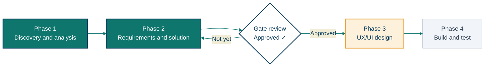

<p align="center">
  
</p>

<p align="center">
  
  
  
  
  
</p>

## About this project

Every weekday morning, before the sun is up, people are already queueing outside the gates of Midlands Community Clinic in Pietermaritzburg. Many arrive before 06:00, wait most of the day, and some are sent home when the daily limit is reached. Older patients, mothers with babies and people with disabilities carry the heaviest load.

I started this project after seeing those queues myself. My aim is to understand **why** the waiting happens before deciding **what** to build. This repository holds the full business analysis, from the first conversations with patients and staff through to signed-off requirements. The analysis will then guide the UX/UI design and the build of an online booking portal for the clinic's three branches.

> **Note:** This is a portfolio case study. Midlands Community Clinic, its staff and the people interviewed are fictional. Research findings are simulated to practise real business analysis techniques in a realistic South African setting.

## Project at a glance

| | |
|---|---|
| **Client** | Midlands Community Clinic (Scottsville, Edendale and Imbali branches) |
| **Problem** | Walk-in-only access causes pre-dawn queues, waits of around 4 hours and about 40 patients turned away each day |
| **Proposed solution** | A mobile-first, accessible booking portal with SMS reminders and assisted booking at reception |
| **Business analyst** | Nkosinathi (Nathi) Ndlovu |
| **Completed** | Phase 1: Discovery and analysis · Phase 2: Requirements and solution |
| **Gate decision** | Approved to proceed to UX/UI design (1 December 2026) |
| **Next phase** | Phase 3: UX/UI design |
| **Scope in numbers** | 9 business requirements · 11 business rules · 27 functional and 10 non-functional requirements · 18 user stories (78 points) · 22 UAT tests |

## Project roadmap



## Phase 1: Discovery and analysis

| # | Document | What it covers |
|---|---|---|
| 01 | [Project brief](01-discovery/01-project-brief.md) | How the project started, vision, objectives, scope and legal context |
| 02 | [Business case](01-discovery/02-business-case.md) | Five options compared with a weighted scoring matrix, and a recommendation |
| 03 | [Stakeholder analysis](01-discovery/03-stakeholder-analysis.md) | Stakeholder register, power and interest grid, RACI and communication plan |
| 04 | [Elicitation plan](01-discovery/04-elicitation-plan.md) | Techniques, schedule, interview guides and consent approach |
| 05 | [Elicitation findings](01-discovery/05-elicitation-findings.md) | Interviews, site observation, patient survey and staff workshop results |
| 06 | [Current-state process](01-discovery/06-current-state-process.md) | How a clinic visit works today, with pain points mapped to each step |
| 07 | [Root cause analysis](01-discovery/07-root-cause-analysis.md) | Fishbone diagram, 5 Whys and the five root causes |
| 08 | [Problem statement](01-discovery/08-problem-statement.md) | Agreed problem, goals, KPIs with baselines, and the Phase 1 sign-off |

## Phase 2: Requirements and solution

| # | Document | What it covers |
|---|---|---|
| 01 | [Future-state process](02-requirements/01-future-state-process.md) | To-be BPMN model, walk-in and slot release flow, pain points resolved |
| 02 | [Business requirements (BRD)](02-requirements/02-business-requirements.md) | Business requirements, 11 business rules, scope, assumptions and sign-off |
| 03 | [Functional and non-functional requirements](02-requirements/03-functional-and-non-functional-requirements.md) | 27 functional and 10 non-functional requirements, prioritised with MoSCoW |
| 04 | [Use cases](02-requirements/04-use-cases.md) | Use case diagram and four detailed use cases with alternative and exception flows |
| 05 | [User stories](02-requirements/05-user-stories.md) | 18 user stories in 5 epics, with Given/When/Then acceptance criteria |
| 06 | [Data model](02-requirements/06-data-model.md) | ERD, data dictionary with POPIA classification, booking life cycle |
| 07 | [RAID log](02-requirements/07-raid-log.md) | Risks, assumptions, issues and the decisions that closed Phase 1's open questions |
| 08 | [Traceability matrix](02-requirements/08-traceability-matrix.md) | Every requirement traced from business objective to test |
| 09 | [UAT plan](02-requirements/09-uat-plan.md) | Entry and exit criteria, testers, 22 test cases and defect severity |
| 10 | [Gate review](02-requirements/10-gate-review.md) | Readiness check and the decision to proceed to UX/UI design |

## Supporting files

| File | Format | Open with |
|---|---|---|
| [as-is-clinic-visit.bpmn](01-discovery/models/as-is-clinic-visit.bpmn) | BPMN 2.0 | [bpmn.io](https://demo.bpmn.io) or Camunda Modeler |
| [stakeholder-register.csv](01-discovery/data/stakeholder-register.csv) | CSV | Excel or Google Sheets |
| [patient-survey-results.csv](01-discovery/data/patient-survey-results.csv) | CSV | Excel or Google Sheets |
| [to-be-booked-visit.bpmn](02-requirements/models/to-be-booked-visit.bpmn) | BPMN 2.0 | [bpmn.io](https://demo.bpmn.io) or Camunda Modeler |
| [product-backlog.csv](02-requirements/data/product-backlog.csv) | CSV (Jira import format) | Jira, Excel or Google Sheets |
| [requirements-traceability-matrix.csv](02-requirements/data/requirements-traceability-matrix.csv) | CSV | Excel or Google Sheets |
| [features/](02-requirements/features) | Gherkin (`.feature`) | Any text editor; runnable with Cucumber or SpecFlow |

## Techniques used

| BABOK® technique | Where it is used |
|---|---|
| Business case and SMART objectives | [01](01-discovery/01-project-brief.md), [02](01-discovery/02-business-case.md) |
| Decision analysis (weighted scoring) | [02](01-discovery/02-business-case.md) |
| Stakeholder list, map and personas | [03](01-discovery/03-stakeholder-analysis.md) |
| Interviews, observation, survey, workshop, document analysis | [04](01-discovery/04-elicitation-plan.md), [05](01-discovery/05-elicitation-findings.md) |
| Process modelling (BPMN 2.0) | [06](01-discovery/06-current-state-process.md) |
| Root cause analysis (fishbone and 5 Whys) | [07](01-discovery/07-root-cause-analysis.md) |
| Metrics and KPIs | [08](01-discovery/08-problem-statement.md) |
| Business rules analysis | [BRD](02-requirements/02-business-requirements.md) |
| Non-functional requirements analysis | [Requirements](02-requirements/03-functional-and-non-functional-requirements.md) |
| Prioritisation (MoSCoW) | [Requirements](02-requirements/03-functional-and-non-functional-requirements.md) |
| Use cases and scenarios | [Use cases](02-requirements/04-use-cases.md) |
| User stories and acceptance criteria (BDD) | [User stories](02-requirements/05-user-stories.md), [features](02-requirements/features) |
| Data modelling and data dictionary | [Data model](02-requirements/06-data-model.md) |
| State modelling | [Data model](02-requirements/06-data-model.md) |
| Risk analysis and management | [RAID log](02-requirements/07-raid-log.md) |
| Requirements traceability | [Traceability matrix](02-requirements/08-traceability-matrix.md) |
| Acceptance and evaluation criteria | [UAT plan](02-requirements/09-uat-plan.md), [Gate review](02-requirements/10-gate-review.md) |

## Repository structure

```text
hospital-booking-business-analysis/
├── README.md
├── assets/
│   └── banner.svg
├── 01-discovery/
│   ├── 01-project-brief.md
│   ├── 02-business-case.md
│   ├── 03-stakeholder-analysis.md
│   ├── 04-elicitation-plan.md
│   ├── 05-elicitation-findings.md
│   ├── 06-current-state-process.md
│   ├── 07-root-cause-analysis.md
│   ├── 08-problem-statement.md
│   ├── data/
│   │   ├── patient-survey-results.csv
│   │   └── stakeholder-register.csv
│   └── models/
│       ├── as-is-clinic-visit.bpmn
│       └── as-is-clinic-visit.svg
└── 02-requirements/
    ├── 01-future-state-process.md
    ├── 02-business-requirements.md
    ├── 03-functional-and-non-functional-requirements.md
    ├── 04-use-cases.md
    ├── 05-user-stories.md
    ├── 06-data-model.md
    ├── 07-raid-log.md
    ├── 08-traceability-matrix.md
    ├── 09-uat-plan.md
    ├── 10-gate-review.md
    ├── data/
    │   ├── product-backlog.csv
    │   └── requirements-traceability-matrix.csv
    ├── features/
    │   ├── book-a-visit.feature
    │   ├── slot-release.feature
    │   ├── sms-privacy.feature
    │   └── walk-in-capacity.feature
    └── models/
        ├── to-be-booked-visit.bpmn
        └── to-be-booked-visit.svg
```

---

<sub>BABOK® is a registered trademark of the International Institute of Business Analysis (IIBA).</sub>
