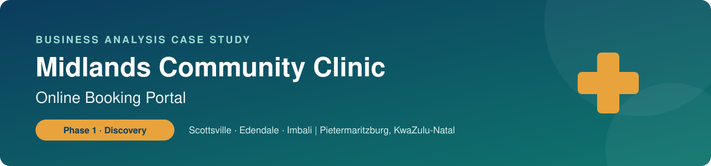
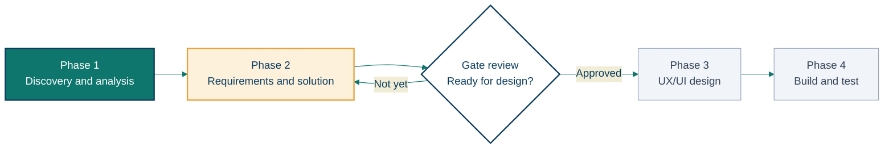

<p align="center">
  
</p>

<p align="center">
  
  
  
  
</p>

## About this project

Every weekday morning, before the sun is up, people are already queueing outside the gates of Midlands Community Clinic in Pietermaritzburg. Many arrive before 06:00, wait most of the day, and some are sent home when the daily limit is reached. Older patients, mothers with babies and people with disabilities carry the heaviest load.

I started this project after seeing those queues myself. My aim is to understand **why** the waiting happens before deciding **what** to build. This repository holds the full business analysis, from the first conversations with patients and staff through to signed-off requirements. The analysis will then guide the UX/UI design and the build of an online booking portal for the clinic's three branches.

> **Note:** This is a portfolio case study. Midlands Community Clinic, its staff and the people interviewed are fictional. Research findings are simulated to practise real business analysis techniques in a realistic South African setting.

## Project at a glance

| | |
|---|---|
| **Client** | Midlands Community Clinic (Scottsville, Edendale and Imbali branches) |
| **Problem** | Walk-in-only access causes pre-dawn queues, waits of around 4 hours and about 40 patients turned away each day |
| **Proposed solution** | A mobile-first, accessible booking portal with SMS reminders and assisted booking at reception |
| **Business analyst** | Nkosinathi (Nathi) Ndlovu |
| **Current phase** | Phase 1: Discovery and analysis (complete) |
| **Next phase** | Phase 2: Requirements and solution definition |

## Project roadmap



## Phase 1: Discovery and analysis

| # | Document | What it covers |
|---|---|---|
| 01 | [Project brief](01-discovery/01-project-brief.md) | How the project started, vision, objectives, scope and legal context |
| 02 | [Business case](01-discovery/02-business-case.md) | Five options compared with a weighted scoring matrix, and a recommendation |
| 03 | [Stakeholder analysis](01-discovery/03-stakeholder-analysis.md) | Stakeholder register, power and interest grid, RACI and communication plan |
| 04 | [Elicitation plan](01-discovery/04-elicitation-plan.md) | Techniques, schedule, interview guides and consent approach |
| 05 | [Elicitation findings](01-discovery/05-elicitation-findings.md) | Interviews, site observation, patient survey and staff workshop results |
| 06 | [Current-state process](01-discovery/06-current-state-process.md) | How a clinic visit works today, with pain points mapped to each step |
| 07 | [Root cause analysis](01-discovery/07-root-cause-analysis.md) | Fishbone diagram, 5 Whys and the five root causes |
| 08 | [Problem statement](01-discovery/08-problem-statement.md) | Agreed problem, goals, KPIs with baselines, and the Phase 1 sign-off |

**Supporting files**

| File | Format | Open with |
|---|---|---|
| [as-is-clinic-visit.bpmn](01-discovery/models/as-is-clinic-visit.bpmn) | BPMN 2.0 | [bpmn.io](https://demo.bpmn.io) or Camunda Modeler |
| [stakeholder-register.csv](01-discovery/data/stakeholder-register.csv) | CSV | Excel or Google Sheets |
| [patient-survey-results.csv](01-discovery/data/patient-survey-results.csv) | CSV | Excel or Google Sheets |

## Techniques used

| BABOK® technique | Where it is used |
|---|---|
| Business case and SMART objectives | [01](01-discovery/01-project-brief.md), [02](01-discovery/02-business-case.md) |
| Decision analysis (weighted scoring) | [02](01-discovery/02-business-case.md) |
| Stakeholder list, map and personas | [03](01-discovery/03-stakeholder-analysis.md) |
| Interviews, observation, survey, workshop, document analysis | [04](01-discovery/04-elicitation-plan.md), [05](01-discovery/05-elicitation-findings.md) |
| Process modelling (BPMN 2.0) | [06](01-discovery/06-current-state-process.md) |
| Root cause analysis (fishbone and 5 Whys) | [07](01-discovery/07-root-cause-analysis.md) |
| Metrics and KPIs | [08](01-discovery/08-problem-statement.md) |

## Repository structure

```text
hospital-booking-business-analysis/
├── README.md
├── assets/
│   └── banner.svg
└── 01-discovery/
    ├── 01-project-brief.md
    ├── 02-business-case.md
    ├── 03-stakeholder-analysis.md
    ├── 04-elicitation-plan.md
    ├── 05-elicitation-findings.md
    ├── 06-current-state-process.md
    ├── 07-root-cause-analysis.md
    ├── 08-problem-statement.md
    ├── data/
    │   ├── patient-survey-results.csv
    │   └── stakeholder-register.csv
    └── models/
        ├── as-is-clinic-visit.bpmn
        └── as-is-clinic-visit.svg
```

---

<sub>BABOK® is a registered trademark of the International Institute of Business Analysis (IIBA).</sub>
